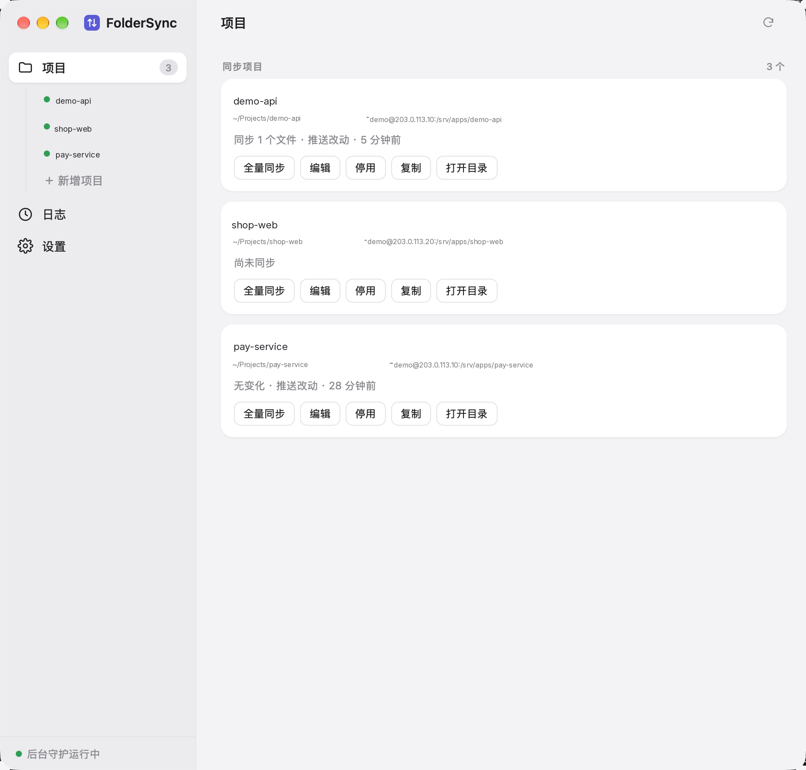

# folder-sync

macOS 上的本地 → 远端单向推送工具。一个配置文件管理多个项目。保存文件后只推送改动的文件（SSH + GNU rsync），配套的菜单栏应用负责查看进度、管理项目，并通过屏幕角落的浮动状态条显示同步状态。



- **改动即推送**：fswatch 监听本地改动，只把变化的文件交给 rsync（`--files-from`），不扫描整个目录。
- **切分支 / 大批量改动自动全量**：`.git/HEAD` 或 reflog 变化（切分支、merge、reset）时，等 git 写完工作区后立即触发一次全量；2 秒内收到的文件事件达到阈值（默认 100，可配置）时也直接全量，不再依赖逐文件事件。
- **不做定时或启动全量**：需要全量时，在项目卡片上点"全量同步"，或执行 `folder-sync sync <项目>`。
- **只推不拉**：任何设置都不会删除本地文件。需要从远端拿文件时，手动"从远端下载"。
- **同步删除远端文件**：每个项目一个开关，默认关闭。打开后，本地删除的文件会立即在远端删除；全量同步时远端多出的文件也会被删除。远端删除不进回收站、不可恢复；`exclude` 中的路径永远不会被删除。
- **以本地为准**：远端文件即使被他人修改过，也直接覆盖。

## 安装

1. 双击 `FolderSync-<版本>.dmg`，把 **FolderSync** 拖到"应用程序"文件夹。
2. 从"应用程序"打开 FolderSync。首次打开时：
   - 应用会检查运行环境；缺少 GNU rsync 或 fswatch 时，会显示要在"终端"执行的命令（`brew install rsync fswatch`），装好后点"重新检测"。
   - 环境齐全后自动完成安装：命令行工具装到 `~/.local/bin/folder-sync`，注册后台同步与开机启动项，然后打开"新增项目"表单。
3. 应用没有签名，第一次打开如被系统拦截：在"应用程序"里右键 FolderSync → 打开，或到"系统设置 → 隐私与安全性"里点"仍要打开"。

**升级**：应用会自动检查更新（启动后一次，之后每 6 小时一次）。发现新版本时，小窗底部或"设置 → 关于"里会出现「更新到 x.y.z」按钮，点一下就会从 GitHub 下载新版、覆盖"应用程序"里的 FolderSync 并自动重启（同时更新命令行工具和后台服务，项目配置不变）。也可以照旧用新版 DMG 手动覆盖安装。
**卸载**：设置 → 卸载 FolderSync。会停止后台同步、删除开机启动项和命令行工具，并把应用移到废纸篓；配置和同步记录保留，重新安装后继续使用。也可以在终端执行 `folder-sync uninstall`。

远端需要可登录的 shell 和 rsync；连接使用 SSH 私钥或 `ssh-agent`。首次连接新服务器时，在项目页点"测试连接"，核对服务器指纹后选择信任。

### 从源码构建

```bash
./app/make-dmg.sh       # 生成 app/build/FolderSync-<版本>.dmg（同时包含 Apple 芯片与 Intel 版本）
./app/build.sh          # 只构建应用（本机架构），开发时用
./folder-sync.sh install  # 开发时：安装命令行工具与后台服务，并把 app/build 里的应用装进"应用程序"
```

只需要 Xcode Command Line Tools，不需要 Xcode。终端里要直接使用 `folder-sync` 命令时，把 `~/.local/bin` 加入 `PATH`。

## 菜单栏应用

- **点击菜单栏图标**：弹出浮层（"项目""日志"两个标签），每个项目一张卡片，显示当前阶段、进度、最近结果，并提供"全量同步 / 停止 / 跳过 / 重试 / 启用·停用 / 编辑"按钮。点右上角 ⤢ 或齿轮可打开大窗口。
- **大窗口**：左侧是"项目（下列各项目）/ 日志 / 设置"导航。项目页可编辑配置、测试连接；"复制"会以当前项目为模板新建（名称加 `-copy`）。命令行 `folder-sync ui` 也能打开大窗口。
- **日志**：只记录有实际变化的同步（"无变化"不记录），每次列出具体文件（↑ 上传、✕ 远端删除、↓ 下载、⤼ 跳过）。只有一个文件时直接显示文件名；多个文件点击标题展开，先显示 15 个，"查看更多"每次再加载 50 个，可随时收起；失败的记录展开后显示错误输出。最多保留并显示最近 1000 条，更早的记录及其文件清单会被自动删除。
- **版本与更新**：小窗底部"退出"左侧显示当前版本号（如 `v2.4.1`）；发现新版本时该位置出现高亮的「更新到 x.y.z」按钮，点击即下载、覆盖安装并自动重启。设置页「关于」里有同样的信息与"检查更新"入口。
- **设置**：开机自动启动（默认开启；关闭后登录时不再自动运行，打开 FolderSync 时才开始同步）、浮动状态条（含位置预览）、改动去抖与不监听的目录、配置备份（导出 / 导入）、后台服务、关于、卸载。
- **配置备份**：系统重装前在设置里「导出配置」，会得到一个 JSON 文件（所有项目 + 本页的应用设置；不含 SSH 私钥和 `known_hosts`）。重装后装好 FolderSync，用「导入配置」选这个文件：默认只补进本机没有的项目，同名项目保留本机配置，导入前自动把当前配置备份成 `config.conf.bak.<时间>`。命令行也可以用 `folder-sync export [文件]` 和 `folder-sync import <文件>`（`--preview` 先看变化，`--replace` 整份替换）。
- **菜单栏图标**：同步中会切换图标；有未确认的失败时显示红色。
- **浮动状态条**：半透明黑底白字，显示在屏幕右下角（可在设置里改为左下角，也可以拖动）。
  - 自动推送超过 2 秒才出现（阈值可调）；手动全量同步、上传、下载会立即出现。
  - 完成后显示"已同步 N 个文件"2 秒，然后消失。
  - 鼠标悬停显示当前文件和"停止"按钮；单个文件传输超过 5 秒时出现"跳过"按钮。
  - 失败时显示红色状态条，一直停留，直到你点"关闭"；旁边的"重试"会对该项目做一次全量同步；点击空白处打开日志页。
  - 多个项目同时同步时按项目叠加显示，最多 3 行。
  - 不再发系统通知。
- **Finder 快速操作**：在规则目录下选中文件或文件夹，右键 → 快速操作 →
  - "FolderSync：上传到远端"：立即推送所选内容。
  - "FolderSync：从远端下载"：先列出将新增 / 覆盖的本地文件，确认后下载，绝不删除本地文件。手动下载不受项目"排除 / 仅包含"规则限制（上传仍按规则过滤）。
  - 如果菜单里没出现，请在"系统设置 → 键盘 → 键盘快捷键 → 服务"中勾选。

## 行为说明

| 操作 | 效果 |
|---|---|
| 停止 | 立即结束本次同步（同时关闭复用的 SSH 连接）。未传完的文件丢弃、不补传；下次有改动时只推新改动。 |
| 跳过 | 结束当前卡住的文件，用剩余清单继续本次同步。被跳过的文件丢弃。 |
| 失败 | SSH 断线会在同一次同步内快速重试 2 次（认证 / 主机指纹错误不重试）；仍失败则丢弃本批，并显示红色状态条。 |
| 并行 | 不同项目并行同步，同一项目串行。同一台服务器、同一个账号共用一条 SSH 连接，空闲 10 分钟后释放。 |
| 配置变更 | 守护进程会自动重载（进行中的同步先结束），不需要 `reload`。 |

## 配置

`~/.config/folder-sync/config.conf`，`[global]` 是全局选项，其余每个段是一个项目：

```ini
[global]
debounce = 1                      # 本地改动去抖（秒）
known_hosts = ~/.ssh/known_hosts  # 设为空会关闭主机指纹校验（不建议）
ssh_multiplex = true
watch_ignore = .git node_modules .idea .vscode .DS_Store
git_trigger = true                # 切分支等 git 元数据变化时自动全量
burst_full = 100                  # 2 秒内事件数达到该值时改走全量；0 = 关闭

[site]
enabled = true
local = ~/work/site
remote = /var/www/site
host = example.com
port = 22
user = deploy
key_file = ~/.ssh/id_ed25519
delete = false                    # true = 同步删除远端文件（不可恢复）
exclude = .git/**, node_modules/**, .DS_Store
# include = *.php, img/**         # 可选：只同步匹配的文件
# remote_owner = www:www          # 可选：对本次传输的路径在远端 chown
# extra =                         # 可选：附加 rsync 参数
```

- **界面与配置文件的关系**：菜单栏应用的编辑界面会改写这个文件，只改动目标行，你手写的注释和旧字段都会保留，原文件备份为 `config.conf.bak`；保存前会先校验。
- **旧字段兼容**：`mode = mirror` 等同于 `delete = true`。`interval`、`notify*`、`engine` 等已不再使用，会被忽略。`direction = remote` 不再支持。

## 命令

| 命令 | 作用 |
|---|---|
| `sync [项目\|路径\|.]` | 手动全量同步；`--bg` 交给守护进程在后台执行 |
| `push <路径...>` | 立即上传所选文件或文件夹 |
| `pull <路径...>` | 从远端下载（先确认；`--preview` 输出 JSON 预览，`--yes` 跳过确认） |
| `cancel [项目]` / `skip <项目> [路径]` | 停止 / 跳过当前文件 |
| `status [-w] [--json]`、`history`、`run-files <run_id>`、`logs` | 查看状态、同步记录、某次同步的文件清单、日志 |
| `ack <项目>` | 确认失败提示 |
| `check [项目]` | 只对比差异，不传输 |
| `list`、`validate`、`test <项目>` | 查看规则、校验配置、测试连接 |
| `rules --json`、`rule-add / rule-set / rule-rm / rule-rename`、`global-set` | 供界面使用的配置读写 |
| `install`、`uninstall`、`autostart [on\|off]` | 安装 / 卸载后台服务与开机启动项（一般由应用自动完成）；开关开机自动启动 |
| `start`、`reload`、`doctor`、`ui` | 启动 / 重启守护、检查运行环境、打开窗口 |
| `trust-host <项目>` | 核对并信任服务器指纹（首次连接新服务器） |

项目正在同步时，手动执行 `sync` 会提示并等待；加 `--no-wait` 则立即返回（退出码 75）。

## 文件位置

- 配置：`~/.config/folder-sync/config.conf`
- 状态：`~/.local/state/folder-sync/`
  - `status/<项目>.run.json`：运行中的实时进度
  - `status/<项目>.last.json`：最近一次结果
  - `history.jsonl`：同步记录（最近 1000 条）；`runs/<run_id>.tsv`：每次同步的文件清单（失败时另有 `.err`），随记录一起自动清理
- 日志：`~/Library/Logs/folder-sync.log`、`~/.local/state/folder-sync/folder-sync.log`
- 应用：`/Applications/FolderSync.app`（命令行工具随应用分发，安装到 `~/.local/bin/folder-sync`）
- 开机启动项：`~/Library/LaunchAgents/com.local.folder-sync*.plist`（关闭开机自启时移到 `~/.local/state/folder-sync/launchd/`）

## 测试

```bash
bash tests/regression.sh   # 本地回归测试，用临时目录模拟远端，需要 GNU rsync 与 fswatch；不会碰本机正在运行的服务
node tests/ui-e2e.js       # 界面测试：用 Chrome 无头模式加载界面的模拟数据，逐项点击验证
```

## 使用限制

- rsync 默认按文件大小和修改时间判断是否传输。
- 软链接不同步。
- 守护进程未运行、或电脑休眠期间的本地改动不会自动补推，需要手动全量同步。
- 菜单栏应用未签名，仅供本机自用。
